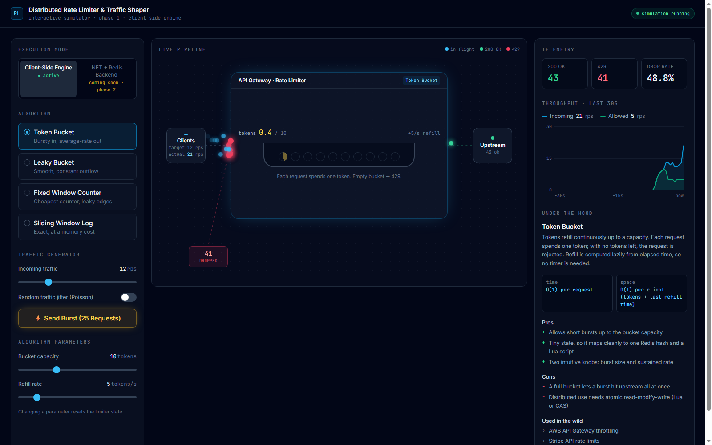
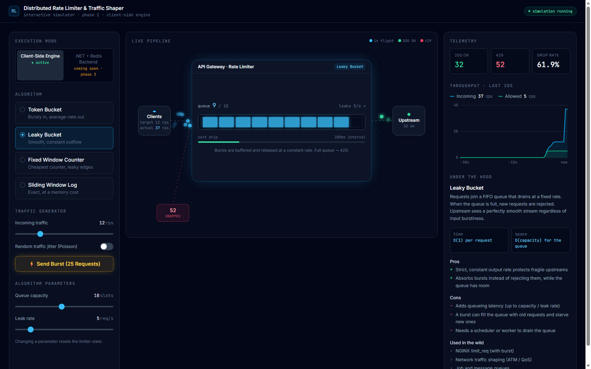
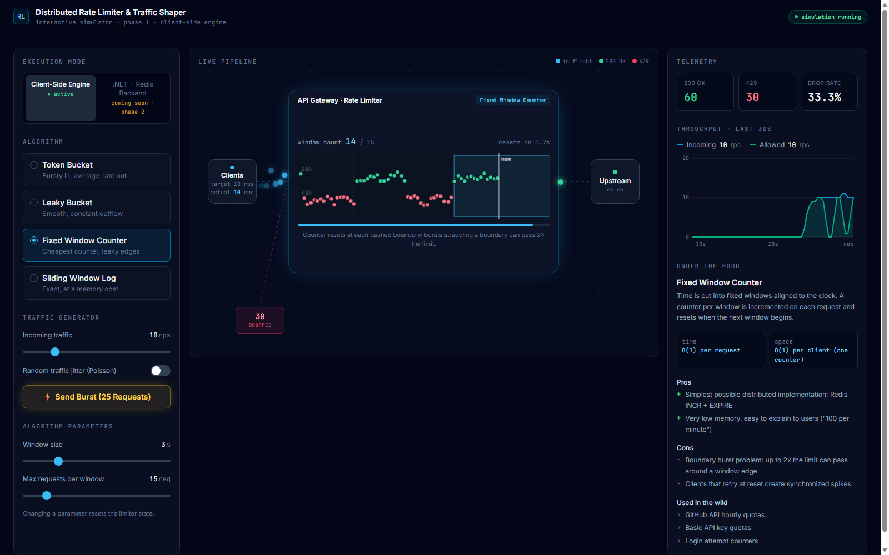
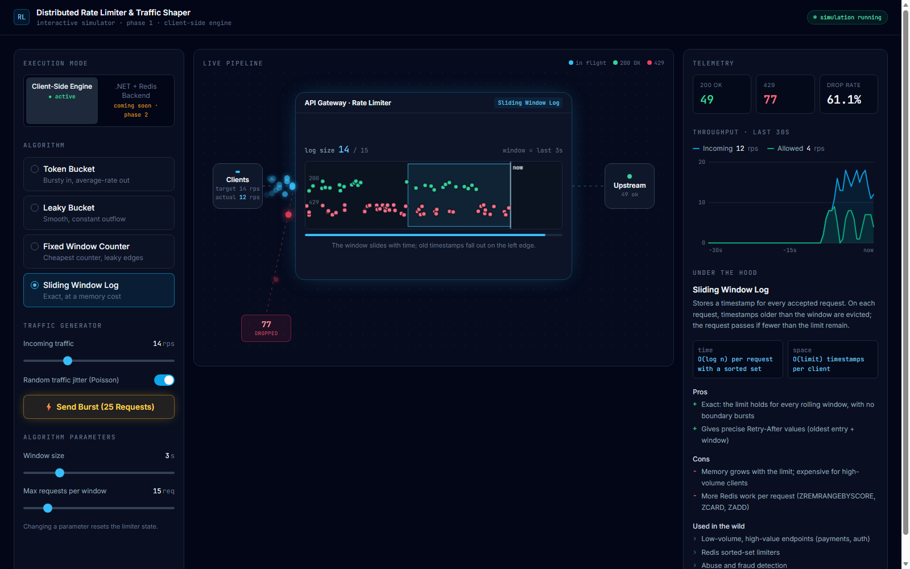

# Distributed Rate Limiter & Traffic Shaper Simulator

An interactive, single-page simulator for four classic rate-limiting
algorithms: **Token Bucket**, **Leaky Bucket**, **Fixed Window Counter**, and
**Sliding Window Log**. Send steady or bursty traffic through an API gateway
and watch each algorithm's internal state, decisions (200 / 429) and
throughput live.

Built with React, TypeScript, Tailwind CSS and Framer Motion.



## Screenshots

| Leaky Bucket | Fixed Window Counter | Sliding Window Log |
|---|---|---|
|  |  |  |
| A burst fills the FIFO queue; upstream still gets a steady 5 rps. | Each window allows up to the limit, then resets at the boundary. | With jitter on, the actual rate varies around the target. |

## Run it

```bash
npm install
npm run dev        # http://localhost:5173
npm run build      # type-check + production build
```

## Distributed gateway (Phase 2, Token Bucket)

Needs the .NET 11 SDK and Docker.

```bash
cd backend
docker compose up --build    # Redis + 3 gateway replicas + NGINX on http://localhost:8080
dotnet test                  # concurrency test: 100 parallel requests across 3 instances
```

The test starts a real Redis with Testcontainers and checks that exactly
`capacity` requests pass, however the burst is interleaved across instances.
Replacing the atomic Lua script with a plain read-then-write makes it fail
(all 100 requests pass).

Try it by hand once the stack is up:

```bash
curl -X PUT localhost:8080/api/rate-limit/config -H 'content-type: application/json' \
  -d '{"algorithm":"token-bucket","capacity":10,"refillRate":1}'
curl -i -X POST localhost:8080/api/rate-limit/evaluate -H 'content-type: application/json' \
  -d '{"requestId":"r1","clientId":"me"}'    # X-Instance shows which replica answered
```

### Use it from the simulator

With the stack up, run `npm run dev` and pick **.NET + Redis Backend** under
Execution Mode. The dev server proxies `/api` to `localhost:8080`, so every
request in the pipeline becomes a real HTTP call through NGINX to one of the
replicas. The gateway box then shows the tokens left after the last allowed
request and how many requests each replica (`X-Instance`) answered. Only Token
Bucket is available in this mode; the other algorithms stay client-side.

## Project layout

```
src/
  algorithms/   Pure, framework-free algorithm classes (readable reference code)
  engine/       IRateLimiterProvider strategy interface
                  ClientSimulationProvider: Phase 1, runs algorithms in-browser
                  RemoteApiProvider: Phase 2 stub for a REST / SignalR backend
  hooks/        useSimulation: traffic generator, particles, telemetry sampling
  components/   Controls, live pipeline + per-algorithm visualizers, telemetry
  data/         "Under the Hood" reference content
backend/
  src/RateLimiter.Gateway/        ASP.NET Core gateway: config + evaluate endpoints
  tests/RateLimiter.Gateway.Tests/ Concurrency test across 3 instances (Testcontainers)
  docker-compose.yml, nginx.conf  Redis + 3 replicas + round-robin load balancer
backend-reference/
  README.md       Phase 2 plan: ASP.NET Core middleware + Redis + Lua
  TokenBucket.lua Atomic Redis token bucket script (embedded by the gateway)
```

### Design notes

- **Algorithms own no clock.** Every method takes `now` explicitly, so the
  classes are deterministic and easy to test or port.
- **The UI only talks to `IRateLimiterProvider`.** Its async
  `evaluateRequest(id)` also models queueing: a Leaky Bucket decision resolves
  only when the request drips out of the queue.
- **Bounded animation state.** A particle is removed from React state when its
  final (200 or 429) animation completes, the particle list is capped, and all
  timers are cleared on unmount. High-frequency metrics live in refs and are
  sampled into state every 500 ms.
